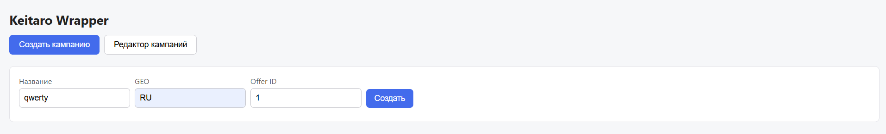
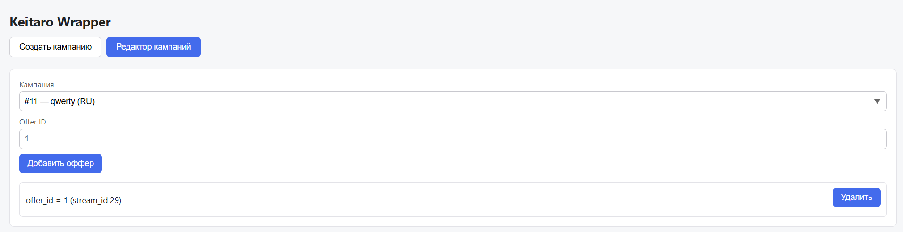
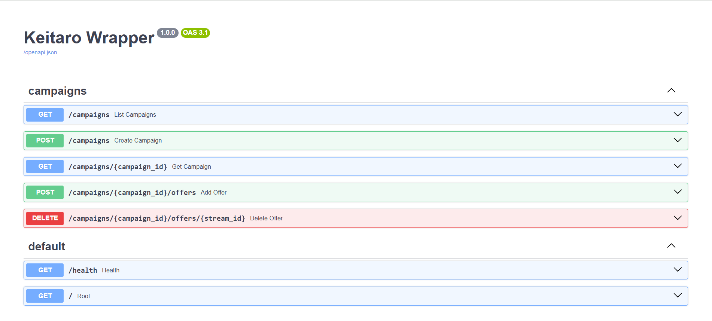
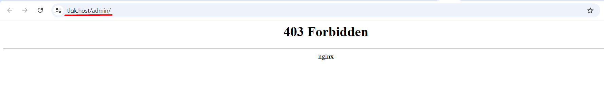

# Keitaro Wrapper

Обёртка над рекламным трекером [Keitaro](https://keitaro.io/) на FastAPI + SQLAlchemy.
Позволяет создавать кампании с двумя потоками (geo-redirect на Google и офферный)
и редактировать офферы существующих кампаний через веб-интерфейс.

## Стек

- **Backend:** FastAPI, SQLAlchemy 2.0 (async), Alembic, SQLite (aiosqlite)
- **HTTP-клиент к Keitaro:** httpx
- **Frontend:** vanilla HTML + JS (без сборки, отдаётся тем же FastAPI)
- **Пакетный менеджер:** uv

## Требования

- Python 3.11+
- [uv](https://docs.astral.sh/uv/) (установка: `winget install astral-sh.uv` или `curl -LsSf https://astral.sh/uv/install.sh | sh`)
- Доступ к инстансу Keitaro с Admin API ключом (для режима 1)

## Переменные окружения

Скопируйте `.env.example` в `.env` и заполните:

| Переменная | Описание | Пример |
|---|---|---|
| `KEITARO_URL` | Базовый URL Keitaro | `https://your-keitaro.example.com` |
| `KEITARO_API_KEY` | Admin API ключ (Обслуживание → Пользователи → Ключи для Admin API) | `abc123...` |
| `KEITARO_DEFAULT_DOMAIN_ID` | ID домена по умолчанию для новых кампаний | `1` |
| `KEITARO_DEFAULT_GROUP_ID` | ID группы кампаний | `1` |
| `KEITARO_DEFAULT_TRAFFIC_SOURCE_ID` | ID источника трафика | `1` |
| `USE_KEITARO_MOCK` | `true` — mock-режим без запросов в Keitaro | `false` |

## Запуск

```bash
# 1. Установить зависимости
uv sync

# 2. Применить миграции БД
uv run alembic upgrade head

# 3. Запустить сервер
uv run fastapi dev app/main.py
```

## Два режима работы

### Режим 1. С реальным Keitaro (production)

Заполните .env:
KEITARO_URL=https://your-keitaro.example.com
KEITARO_API_KEY=...
KEITARO_DEFAULT_DOMAIN_ID=1
KEITARO_DEFAULT_GROUP_ID=1
KEITARO_DEFAULT_TRAFFIC_SOURCE_ID=1
USE_KEITARO_MOCK=false

### Режим 2. Mock (для локальной разработки / демо без Keitaro)

Без реальных запросов, всё в памяти процесса. Удобно, чтобы
посмотреть UI и убедиться, что создание/редактор работают.

USE_KEITARO_MOCK=true  (остальные KEITARO_* можно оставить пустыми)

⚠️ Mock не отправляет запросы в Keitaro, но сохраняет кампании и
потоки в локальную SQLite — поэтому сценарии "создать → добавить
оффер → удалить" работают полностью. Переключение режимов — одна
переменная в .env, код не меняется.

## Как пользоваться
Приложение — одностраничное, две вкладки:

### Вкладка «Создать кампанию»
Введите название кампании, GEO-код страны (2 буквы, например RU) и ID оффера из Keitaro.

Нажмите «Создать».

Приложение создаст в Keitaro кампанию с двумя потоками:

Поток 1 (forced, redirect): ловит трафик из указанной страны и редиректит на https://www.google.com.

Поток 2 (regular, offers): редиректит на указанный оффер.

После успеха приложение автоматически переключится на вкладку «Редактор» и выберет созданную кампанию.

### Вкладка «Редактор кампаний»
Выберите кампанию из выпадающего списка (загружается из локальной БД).

Увидите список офферов (потоки с kind="offer").

Чтобы добавить оффер: введите ID оффера и нажмите «Добавить оффер».

Чтобы удалить: нажмите «Удалить» рядом с оффером.

## API
Все эндпоинты доступны через Swagger UI (/docs):

- POST /campaigns — создать кампанию (name, geo, offer_id) → создаёт в Keitaro кампанию + 2 потока

- GET /campaigns — список кампаний из локальной БД

- GET /campaigns/{id} — одна кампания с потоками

- POST /campaigns/{id}/offers — добавить оффер (создаёт новый поток в Keitaro)

- DELETE /campaigns/{id}/offers/{stream_id} — удалить оффер (удаляет поток в Keitaro)

- GET /health — healthcheck

## Дизайн-решения
Каждый оффер = отдельный поток в Keitaro. В Keitaro офферы привязываются к потокам,
а не к кампании напрямую. Поэтому «добавить оффер в кампанию» реализовано как создание
нового потока с этим оффером, а «удалить оффер» — как удаление соответствующего потока.
Это упрощает редактор: каждый оффер управляется независимо, без конфликтов в общем потоке.

## Ограничения
- CORS: allow_origins=["*"] — для тестового задания. В проде нужно ограничить конкретными доменами.

- SQLite: используется для простоты развёртывания. В проде — PostgreSQL.

- Без авторизации: любой, кто имеет доступ к приложению, может создавать/удалять кампании.
В проде нужна аутентификация.

- Mock в памяти: при перезапуске сервера mock-данные теряются. Это осознанно: mock — для демо, а не для хранения. Реальные данные в Keitaro при этом не затрагиваются.

- Один инстанс: нет горизонтального масштабирования, mock не шарится между воркерами.

## Статус интеграции с Keitaro

На момент сдачи инстанс Keitaro (tlgk.host) недоступен: 
nginx возвращает 403 Forbidden на /admin/ и /admin_api/v1/* 
с любого IP (проверено с двух сетей). Код интеграции был 
разработан и проверен на реальном Keitaro до блокировки. Демонстрация UI — в mock-режиме.

## Подтверждение работы с реальным Keitaro (до блокировки)

21.11.2026, до появления 403, клиент успешно получал данные:

`$ uv run python test_keitaro.py
Campaigns: 5
217584 test_sinelnikov_campaign20261121145245
217583 test_mironov_dem0_company
217582 test_gladun_campaign1
Streams in campaign 217584: 2`

## Скриншоты








## Как использовал ИИ
Проект написан с активным использованием ИИ-агента (по условиям задания это приветствуется).
Процесс был итеративный: агент генерировал каркасы, я проверял на реальном Keitaro
через Swagger и curl, отбрасывал нерабочие варианты и правил под фактическое поведение API.

Ключевые моменты, где ИИ помог и где я правил вручную:

- Клиент Keitaro (app/keitaro.py): сгенерирован агентом по точной Swagger-спеке. Ручная правка — путь list_streams (оказался GET /campaigns/{id}/streams, а не GET /streams?campaign_id=...).

- Модели SQLAlchemy (app/models.py): сгенерированы агентом. Добавил lazy="selectin" на Campaign.streams, чтобы избежать N+1 в редакторе.

- Миграция Alembic: агент настроил env.py (target_metadata = Base.metadata), сгенерировал и применил миграцию.

- Роутер (app/routers/campaigns.py): сгенерирован агентом по точным JSON-структурам потоков из Swagger. Ручная правка — устранение задвоения префикса /campaigns (агент поставил prefix и полный путь в декораторах одновременно).

- Фронтенд (app/static/index.html): сгенерирован агентом, стили и UX-правки вручную (скрытие пустого блока ошибок, обновление списка кампаний после создания, стилизация select).

- Mock-режим: сгенерирован агентом как stateful-хранилище в памяти, чтобы демо-сценарий «создать → добавить → удалить» работал end-to-end без Keitaro.